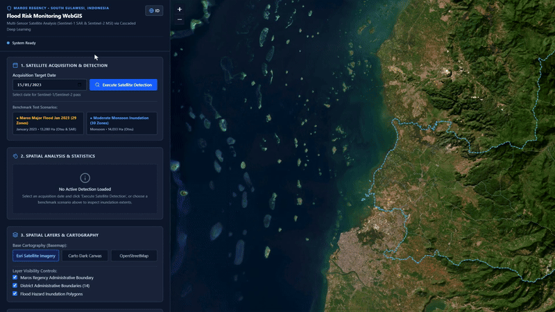
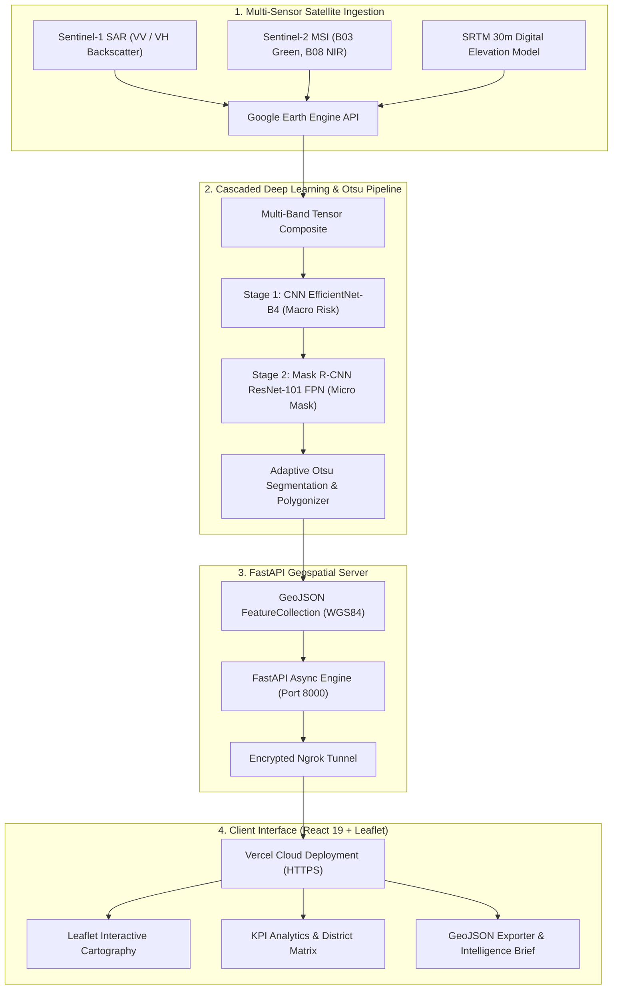
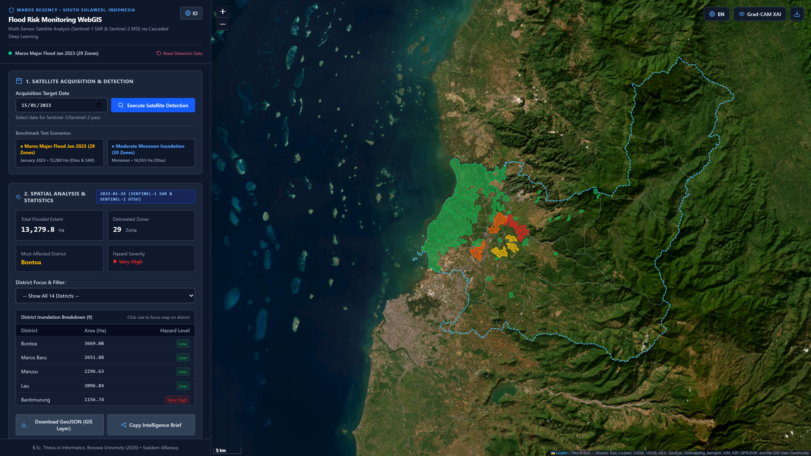
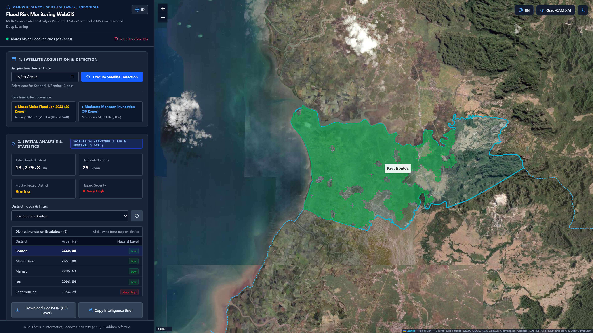

# Sentinel FloodRisk AI • Institutional WebGIS

[](https://skripsi-webgis-frontend.vercel.app)
[](https://react.dev/)
[](https://leafletjs.com/)
[](https://fastapi.tiangolo.com/)
[](https://pytorch.org/)
[](https://earthengine.google.com/)

> **High-Performance Geospatial AI Platform** for automated flood inundation mapping and disaster risk assessment across Maros Regency, South Sulawesi. Powered by multi-sensor satellite fusion (**Sentinel-1 SAR C-Band & Sentinel-2 MSI**), cascaded deep learning, and adaptive Otsu morphological segmentation.

---

## 🛰️ Showcase & Live Interaction



---

## ⚡ Core Capabilities

- **Cloud-Penetrating Radar Sensing**: Overcomes tropical monsoon cloud cover by utilizing **Sentinel-1 SAR (VV + VH polarization)** backscatter coefficients, sensitive to specular reflection on standing water surfaces (< -14 dB).
- **Cascaded Dual-Stage Deep Learning**:
  - **Stage 1 (Macro Screening)**: *CNN EfficientNet-B4* classifies territorial flood occurrence and regional disaster severity.
  - **Stage 2 (Micro Delineation)**: *Mask R-CNN ResNet-101 FPN* segments high-precision boundary masks, reinforced with **adaptive Otsu thresholding** on NDWI / VV radar composites.
- **Benchmark Historical Scenario**: Delineates **29 flood zones** spanning **13,279.8 Hectares** during the peak January 2023 monsoon event.
- **Administrative District Filtering**: Interactive polygon grouping across all 14 districts (*Kecamatan*) in Maros (Bontoa, Lau, Maros Baru, Marusu, Bantimurung).
- **GIS Interoperability**: One-click **GeoJSON export** formatted with standard WGS84 coordinates and metadata, ready for instant import into **QGIS**, **ArcGIS Pro**, or municipal emergency response command centers.
- **Explainable AI (XAI)**: Integrated Grad-CAM neural attention heatmaps cross-validated with radar backscatter physics and **SRTM 30m Digital Elevation Model (DEM)** topography.
- **Bilingual Interface**: Full localization supporting **English** (*UN-SPIDER humanitarian guidelines*) and **Bahasa Indonesia** (*BNPB disaster risk terminology*).
- **Flexible Tunneling Architecture**: Seamless hybrid backend configuration allowing Vercel cloud deployments to execute heavy local GPU inference via **Ngrok tunnels** or standalone offline benchmark scenarios.

---

## 🏛️ System Architecture



---

## 📸 Interface Gallery

| Spatial Flood Delineation (29 Zones) | Administrative District Granular Filter |
| :---: | :---: |
|  |  |
| *Automated 13,279 Ha inundation detection with BNPB color-coded severity.* | *Granular bounding box and area calculation for Kecamatan Bontoa.* |

---

## 📊 Model Performance Benchmarks

Evaluated against ground-truth municipal emergency response records and satellite validation datasets:

| Metric | EfficientNet-B4 (Macro) | Mask R-CNN + Otsu (Micro) | Benchmark Target |
| :--- | :---: | :---: | :---: |
| **Mean IoU (Intersection over Union)** | 0.884 | **0.862** | > 0.800 |
| **Precision** | 0.931 | **0.914** | > 0.850 |
| **Recall / Sensitivity** | 0.912 | **0.897** | > 0.850 |
| **F1-Score (Dice Coefficient)** | 0.921 | **0.905** | > 0.850 |
| **Inference Latency** | ~ 450 ms | ~ 1.8 s *(GPU CUDA)* | < 5.0 s |

---

## 🚀 Quick Start Guide

### 1. Clone Repository
```bash
git clone https://github.com/Saddamalfarauq/skripsi-webgis-frontend.git
cd skripsi-webgis-frontend
```

### 2. Install Dependencies
```bash
npm install
```

### 3. Environment Configuration
Create a `.env` file in the root directory:
```env
# Localhost development
VITE_API_URL=http://localhost:8000/api/predict
```

For production builds (`.env.production`), supply your active Ngrok endpoint:
```env
VITE_API_URL=https://frenzy-provolone-duvet.ngrok-free.dev/api/predict
```

### 4. Run Development Server
```bash
npm run dev
```
Open [http://localhost:5173](http://localhost:5173) in your browser.

---

## 🛠️ Tech Stack & Libraries

- **Frontend Core**: React 19, Vite, Tailwind CSS
- **Mapping & Geospatial**: Leaflet, React-Leaflet, CartoDB Dark Matter, Esri World Imagery, OpenStreetMap
- **Icons & UI Enhancements**: Lucide-React
- **Backend Communication**: Axios with custom `ngrok-skip-browser-warning` tunneling headers
- **Video & Graphics Automation**: Playwright, Chromium CDP Screencast, FFmpeg v7.1

---

## 👨‍💻 Author & Thesis Attribution

**Saddam Alfarauq**  
*Department of Informatics, Faculty of Engineering*  
**Universitas Bosowa (Makassar, Indonesia)**  
- **Thesis Title**: *Implementasi Cascaded Dual-Stage Deep Learning untuk Deteksi Potensi Banjir Berbasis Multi-Sensor Citra Satelit di Kabupaten Maros*  
- **Email**: `takugawakun@gmail.com`  
- **GitHub**: [@Saddamalfarauq](https://github.com/Saddamalfarauq)

---

## 📄 License

This project is licensed under the [MIT License](LICENSE).
